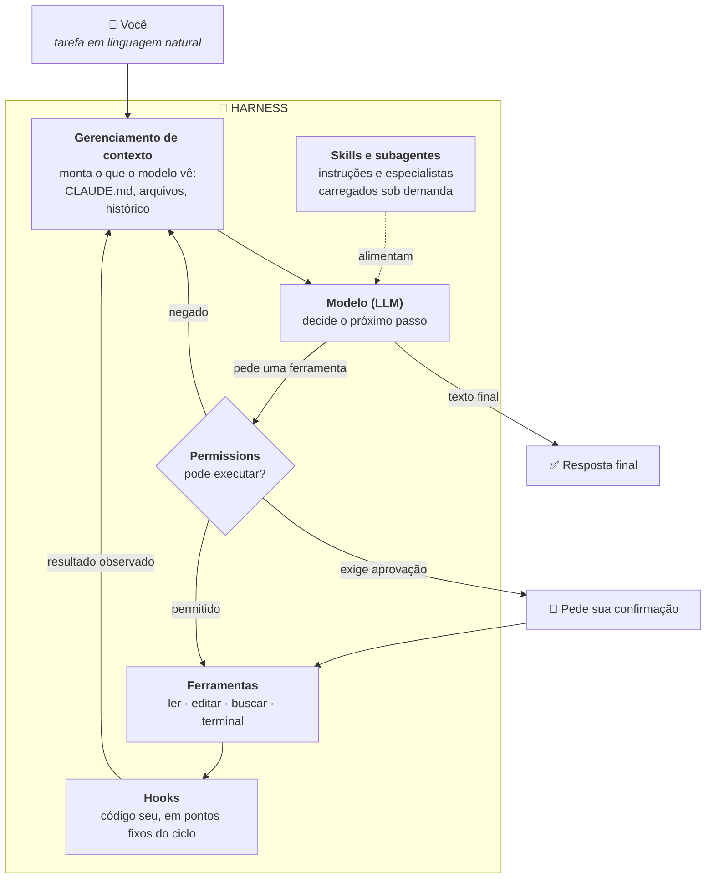

# 6.1 — O que é um Harness de Agentic Coding

> **Harness**: a camada de software que envolve um LLM e o transforma num agente capaz de
> ler, escrever e executar código num projeto real — gerenciando o loop agentic (módulo 4),
> as ferramentas disponíveis, o contexto do projeto, permissões e a interface com o usuário.

## O que diferencia um harness de um chat comum

Um chat com IA (como conversar com Claude via web) é uma troca de mensagens em texto. Um
**harness de agentic coding** — como o Claude Code — é isso somado a um conjunto de
ferramentas concretas (ler arquivo, editar, rodar comando no terminal, buscar no
código) e a um loop agentic (módulo 4.2) que decide, de forma autônoma, quais ferramentas
usar para completar uma tarefa.

```
Chat comum:           Você pergunta → modelo responde em texto → fim

Harness agentic:       Você dá uma tarefa → modelo lê arquivos, edita código, roda
                        testes, itera — tudo isso de forma autônoma, dentro de um
                        loop — até a tarefa estar completa (ou pedir sua confirmação)
```

## As peças que compõem um harness

| Peça | Função |
|---|---|
| **Loop agentic** | O ciclo raciocinar → agir → observar (aula 4.2), rodando até a tarefa terminar |
| **Ferramentas nativas** | Ler/escrever arquivo, buscar em código, rodar comandos de terminal |
| **Gerenciamento de contexto** | Decidir o que cabe na janela de contexto (módulo 1.2): quais arquivos ler, quando resumir |
| **Permissions** | Controle sobre o que o agente pode fazer sem confirmação humana (aula 6.5) |
| **Hooks** | Pontos de extensão que rodam código customizado em momentos do ciclo (aula 6.2) |
| **Skills e subagents** | Formas de estender/especializar o comportamento do agente (aulas 6.3 e 6.4) |

## Como as peças se encaixam

O diagrama abaixo mostra o caminho completo de uma tarefa dentro de um harness real. Repare
que o modelo aparece como **uma** caixa entre várias: quase tudo o que faz um agente de
código funcionar bem está em volta dele, não dentro dele.



Três leituras importantes desse desenho:

**O ciclo é o que gera autonomia.** A seta que volta de `Hooks` para o gerenciamento de
contexto fecha o loop: cada resultado observado vira entrada da próxima decisão. É por isso
que o agente consegue editar um arquivo, rodar o teste, ver a falha e corrigir — sem você no
meio de cada passo.

**O modelo nunca executa nada.** Ele apenas *pede* uma ferramenta pelo nome. Quem executa de
fato é o harness, e sempre depois de passar pelo filtro de permissions. Essa separação é o
que torna a autonomia segura: entre a intenção do modelo e o seu disco existe uma camada de
código que você controla.

**As peças customizáveis estão nas bordas.** Contexto, skills, subagentes, permissions e
hooks são todos configuráveis por você — e são exatamente as caixas que cercam o modelo.
Melhorar um harness para o seu projeto é trabalhar nessas bordas, não no miolo.

## O que o harness acrescenta além do loop

Um loop agentic cru — modelo, ferramentas e repetição — já funciona, mas produz um agente
genérico e arriscado. As peças ao redor resolvem problemas concretos que só aparecem quando
o modelo passa a agir de verdade:

| Problema que surge com a autonomia | Peça que resolve |
|---|---|
| Ele não conhece as convenções do meu projeto | Contexto (`CLAUDE.md`) |
| Ele pode rodar um comando destrutivo | Permissions (aula 6.5) |
| Uma regra minha precisa valer **sempre**, sem depender de o modelo lembrar | Hooks (aula 6.2) |
| Tenho um procedimento repetitivo, com passos que sempre esqueço de pedir | Skills (aula 6.3) |
| Uma sub-tarefa longa polui o contexto principal | Subagentes (aula 6.4) |

As próximas quatro aulas cobrem essas peças, uma a uma.

## Prática

Para ver o miolo do diagrama funcionando, construímos em Python o núcleo do harness — o loop,
as ferramentas de arquivo e o confinamento a uma pasta de trabalho — em
[`exemplos-python/6.1_mini_harness.py`](exemplos-python/6.1_mini_harness.py).

## Pontos-Chave

✅ Um harness soma ao LLM: ferramentas concretas, loop agentic, gerenciamento de contexto e permissions.
✅ A diferença central para um chat comum é a autonomia: o harness decide os passos, não você.
✅ O modelo nunca executa nada: ele pede uma ferramenta, e o harness executa depois de checar permissions.
✅ As peças customizáveis (contexto, hooks, skills, subagentes, permissions) cercam o modelo — é nelas que você adapta o harness ao seu projeto.

## Documentação Oficial (EN)

- [Anthropic — Claude Code Documentation](https://docs.claude.com/en/docs/claude-code/overview)
- [Anthropic — Claude Code Best Practices](https://www.anthropic.com/engineering/claude-code-best-practices)

---
[← Voltar ao módulo](README.md) | [Próxima aula →](6.2-criando-e-testando-um-hook.md)
